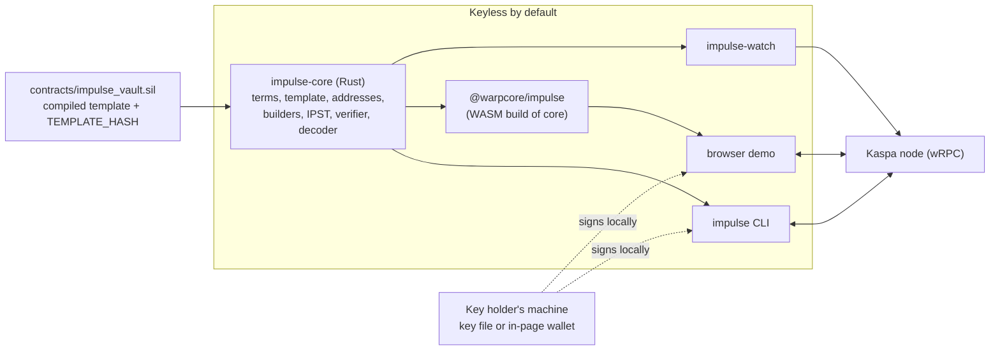
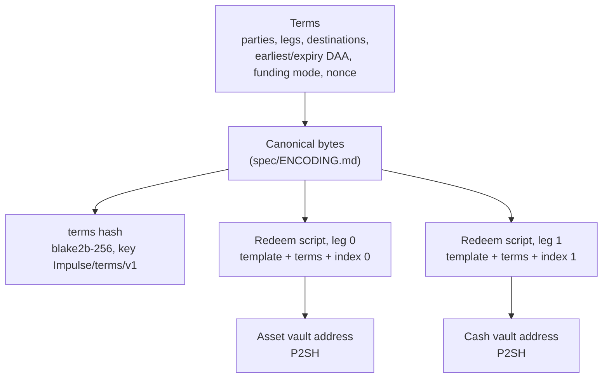
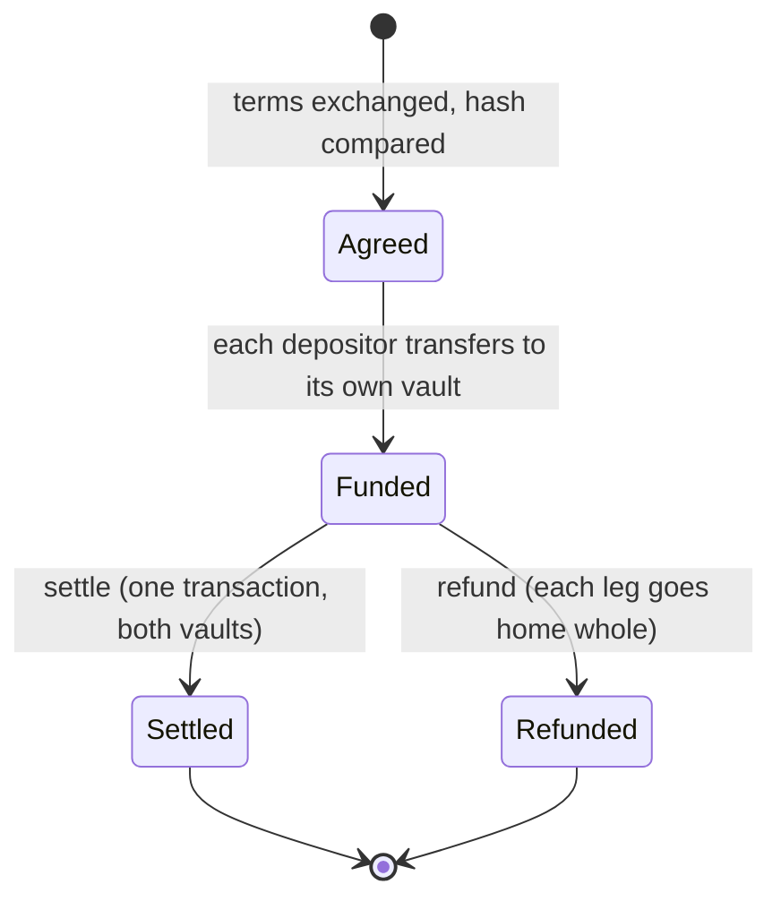
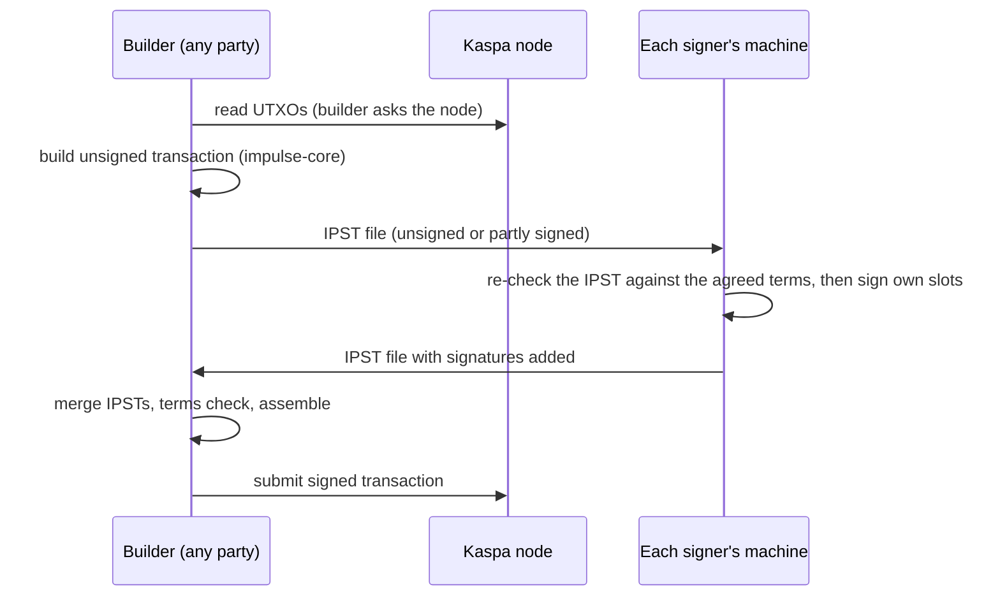

# Architecture

How the parts of Impulse v0.1 fit together. The design is `spec/IMPULSE-SPEC.md` and is authoritative; this document is a map of it. Where this page and a spec differ, the spec is right. v0.2 and v0.3 extensions are not described here (see the end).

## The idea in four sentences

1. A trade is a set of **terms**. The terms have a canonical byte encoding and a **terms hash**.
2. Each escrowed leg has a **vault**: the one contract template (`ImpulseVault`) with the terms and the leg's index compiled in. The vault's address is the pay-to-script-hash of that script, so the address commits to the whole deal.
3. Each party funds its own vault by an ordinary transfer to an address it computed itself. There is no program call and no stored trade record.
4. One **settle** transaction spends both vaults and pays each side what the terms say, or each leg goes home with a **refund**. The script enforces the outputs; nobody has to be trusted to route them.

## Components

| Component | Location | Role |
| --- | --- | --- |
| Template | `contracts/impulse_vault.sil`, `contracts/compiled`, `contracts/TEMPLATE_HASH` | The one contract. Two entries, `settle` and `refund`. Compiled with silverscript v1.0.0; CI rebuilds it and fails unless the output is byte-identical to the committed artifact. |
| `impulse-core` | `crates/impulse-core` | Everything the other components share: terms schema, canonical encoding and hash (`spec/ENCODING.md`), template instantiation and decoding (`spec/TEMPLATE.md`), vault addresses, unsigned transaction builders and sighashes (`spec/TRANSACTIONS.md`), the IPST format (`spec/IPST.md`), the verifier and decoder (`spec/VERIFY.md`). The default build holds no key material. A cargo feature `threshold` (off by default) adds FROST (`spec/THRESHOLD.md`). |
| `impulse` CLI | `crates/impulse-cli` | Terms files, addresses and funding URIs, builders, local signing from a key file you name, IPST merge, submit, decode, receipts, FROST commands (`spec/CLI.md`). Acts on testnet unless `--network mainnet` is passed. |
| SDK | `crates/impulse-wasm` | `impulse-core` compiled to WebAssembly with TypeScript types. Every operation is implemented once, in Rust. |
| `impulse-watch` | `crates/impulse-watch` | Follows a node's virtual chain and reports per-leg JSON events: funded, settled, refunded, final, reorg (`spec/WATCH.md`). Holds no key. |
| Demo | `demo/` | A static page over the SDK with two in-page wallets. Not deployed from this repository. |
| Test kit | `tests/engine`, `tests/parity`, `tests/vectors` | Golden vectors, a test of every contract entry and refusal in the real Kaspa script engine, and the parity suite that generates `PARITY.md`. |

## Terms, template, vault

- **Terms** hold every economic fact: the two party keys and an optional authority key, each leg (kind, token identity, exact amount), four destinations (buyer delivery, seller proceeds, and where each leg goes home), an earliest settle time, an expiry, the funding mode and a random nonce. The nonce distinguishes repeat trades between the same parties.
- **Validation has two stages.** Structure checks are time-independent and mandatory. Creation checks run when terms are made: the network matches, and the expiry lies after the current DAA score and within the horizon. Existing trades are not re-checked against creation rules when settled or refunded.
- **The vault of a leg** is the template with the terms and the leg index. Both vaults check both deliveries, so neither references the other and there is no cross-vault state.
- **A verifier needs only the terms.** Anyone can recompute both addresses. That is the check a funder runs before sending anything.

### Leg shapes

| Leg | Escrow |
| --- | --- |
| Native KAS | One UTXO at the vault holding exactly the leg amount. |
| KCC-20 token | Two UTXOs created together: the escrowed token, owned by the vault's script hash, and a small KAS **authorizer** UTXO at the vault. KCC-20 lets the token move only in a transaction that spends the authorizer, and the authorizer spends only if the Impulse rules hold. |

In v0.1 the asset leg is always KCC-20. Native KAS against a token is expressed by swapping the buyer and seller roles. Native KAS against external cash is not supported.

## Lifecycle

There is no third state and no on-chain record to clean up. Time enters through two DAA-score bounds in the terms: `earliest_daa` (settle not before) and `expiry_daa` (in earmarked mode, the depositor's own refund opens after it). The effective boundaries are one score later than the numbers in the terms, because the node includes a transaction with lock time `x` only from DAA score `x + 1` (`spec/TRANSACTIONS.md`).

### The settle transaction

One transaction settles exactly one trade, with fixed positions (`spec/IMPULSE-SPEC.md`, "Canonical settle transaction"):

| Position | Input | Output |
| --- | --- | --- |
| 0 | Asset-leg authorizer | Asset to `buyer_delivery` |
| 1 | Cash-leg authorizer, or the KAS cash itself | Cash to `seller_proceeds` |
| 2 | Escrowed asset token | Asset authorizer's KAS back to the seller |
| 3 | Escrowed cash token (KCC-20 cash only) | Cash authorizer's KAS back to the buyer (KCC-20 cash only) |
| 4 onward | Submitter's fee inputs | Submitter's change |

Fees always come from the submitter's inputs, so delivered amounts are exact. A leg settles only from a UTXO that holds exactly the leg amount.

### Settlement modes

| Mode | Escrow | Who settles |
| --- | --- | --- |
| Direct | None. Both parties sign one transaction over their own UTXOs. | Whoever holds the fully signed transaction |
| Vault, authority | A vault per leg | The settlement authority (one key, or a FROST group presenting one key) |
| Vault, self-settling | A vault per leg, no authority key | Anyone, once both legs are funded; outputs are fixed by the script |
| Vault, external cash | Asset vault only | The authority, after the off-chain payment is confirmed |

Two funding modes apply to every vault mode: **revocable** (the depositor can withdraw at any time) and **earmarked** (the depositor cannot withdraw before expiry; the counterparty or authority can still send the leg home). Direct terms are always revocable.

## The IPST and the signing flow

Nobody builds and signs in one place. The flow is split so that signing stays with the key holder:

An **IPST** (Impulse partially signed transaction, `spec/IPST.md`) carries the unsigned transaction, the terms, the sighash of every slot and the signatures collected so far. It is untrusted input: before signing, `impulse ipst sign` checks that the IPST is for the terms the signer named, that the document is exactly the transaction the builders make for those terms from its own inputs, that the signer's own destinations are its own, and that the value cap holds. A node that lies about a UTXO's amount or script cannot redirect a signature, because each sighash commits to the amount and script of the UTXO it spends.

## Trust boundaries

| Boundary | What crosses it | What is trusted |
| --- | --- | --- |
| Counterparty to you | Terms, IPST files, funding URIs | Nothing. You recompute the terms hash and both addresses, and the role check refuses terms whose destinations for your role pay the counterparty or the authority. |
| Tool to key | A digest to sign | Only the signing module (`crates/impulse-cli/src/signing.rs`) reads a key file, and only one you name. The default `impulse-core` build holds no key. |
| Tool to node | wRPC calls | The node is the trust anchor for the creation DAA score and for submitted transactions. On mainnet a typed DAA score is refused, and the node URL must be `wss://` or loopback. |
| Authority to trade | One signature in `settle` | The authority can only settle the agreed trade or refund it home. Outputs are script-enforced, so it cannot redirect proceeds. In external-cash mode the script cannot check the off-chain payment, so the seller trusts the authority for that fact. |
| Token issuer to trade | A KCC-20 token | Impulse issues nothing and assesses nothing about a token. Only a pinned kcc20.sil build is funded; every KCC-20 leg carries a `TOKEN_UNASSESSED` warning unless token evidence is supplied. |
| Watcher to chain | Acceptance events | Events are data from one node. A `final` event at depth N makes a deeper reorg unlikely, not impossible. |

### Keys

The exceptions to "no key anywhere" are narrow and listed in the project rules, rule 1:

- the opt-in FROST commands, which hold one party's own share in a file on that party's machine (mode 0600, never printed, logged or sent), with signing nonces in process memory only;
- the demo page's in-page wallets, whose keys are generated in the user's browser, held in memory only and wiped on exit.

## The FROST authority

A settlement authority may be a t-of-n group. On chain it is one x-only key and one BIP-340 signature, so there is no contract or template change. Key generation is a dealer-free distributed protocol (`impulse frost keygen`); signing is two rounds (`impulse frost sign`) and aggregation needs no secret (`impulse frost aggregate`). See `spec/THRESHOLD.md`, which separates what the engine tests measured from what the cryptography asserts.

## The watcher

`impulse-watch` polls a node's virtual selected parent chain from a cursor and reports what happened to each watched vault. Events are attributed per leg, never per trade, because one settle transaction can spend vaults of different trades. A spend is attributed by the UTXO the input spent, not by its signature script alone. It can rebroadcast a signed transaction you name with `--keep-signed` if a reorg removes it, but never past a trade's expiry. The finality depth is the operator's choice and has no default. State is a local file; the trades' terms are supplied again on restart. Details: `spec/WATCH.md`, operation: `docs/OPERATIONS.md`.

## The SDK and the demo

The SDK exposes `impulse-core` to TypeScript: terms, validation, vault addresses, builders, IPST, verifier, decoder, funding instructions and the role check (`crates/impulse-wasm/npm/README.md`). It is keyless except for one class, `Wallet`, added for the demo. The demo (`demo/README.md`) is a static page that loads nothing from third parties; its wallets are for signing and paying fees, not for keeping KAS.

## Verification of the design

| Property | Where it is checked |
| --- | --- |
| Every `require` in the template has a failing test through the real script engine | `tests/engine` |
| Template source equals committed artifact equals `TEMPLATE_HASH` | `scripts/build-template.sh`, CI |
| Encoding and addresses are stable | `tests/vectors`, `scripts/vectors.sh` (diff must be empty) |
| Every stable error code is catalogued | `spec/ERRORS.md`, kept in step by tests in `tests/parity` |
| Differences from the Solana Foundation DvP program | `PARITY.md`, generated by `scripts/gen-parity.sh` |

These are properties of the code and tests in this repository. They are not statements about the security of KCC-20, silverc or rusty-kaspa, on which Impulse depends.

## Extension points

Neither release below is on `main`. Each design file lives on its release branch.

- **Settlement shapes.** v0.1 settles one trade of two legs in full. "v0.2 adds basket settlement (N legs in one transaction), partial settlement and a cross-chain hashlock template": `spec/V2.md` on the `release/v0.2` branch.
- **Proof-carrying settlement.** "v0.3 adds list-gated settlement carrying a zero-knowledge proof": `spec/V3-ZK.md`.
- **Template.** The template hash pins the source, so the v0.1 template never changes. A new contract shape is a new template with a new hash and new terms version.

## Out of scope at every version

Multi-party netting, price discovery, custody, and any server that holds keys. The bank-facing lifecycle (ISO 20022 instructions, matching, compliance, post-trade) is a separate commercial layer built on Impulse, not part of it.
